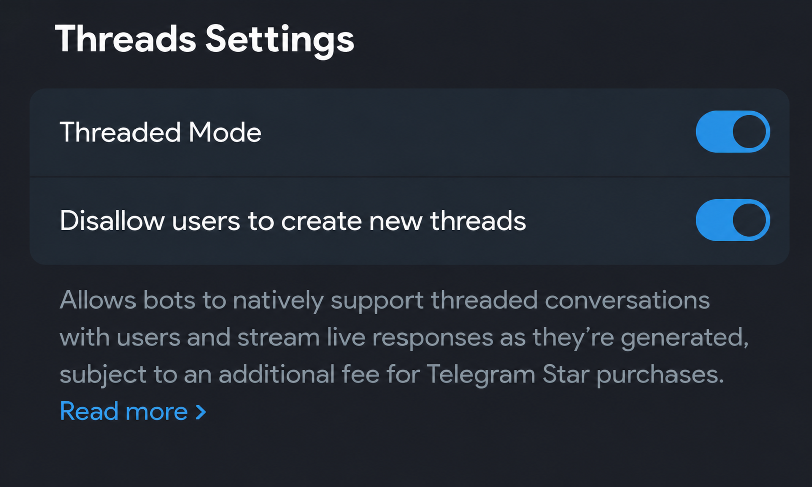

<div align="center">

<h1>Gemini Account Manager TG</h1>

<p>Telegram Business / MTProto · Message history · Gemini API</p>

<p>
  
  
  
  
</p>

</div>

Асинхронный менеджер Telegram-аккаунтов с обработкой Business- и MTProto-событий,
историей сообщений, зашифрованным хранилищем вложений и интеграцией Gemini API.

## Функциональность

- Регистрация Telegram-сессий, управление состоянием и параметрами мониторинга.
- Сохранение сообщений, редакций и событий удаления из Business API и MTProto.
- Порционная догрузка истории личных переписок с сохранением прогресса.
- Мониторинг появления и удаления диалогов.
- Архивирование фото, видео и документов; пересылка spoiler/TTL-медиа.
- Разграничение доступа, управление администраторами и перенос владения аккаунтами.
- Генерация ответов через Gemini по префиксу `.`.
- Автообновление, статистика сессий и уведомления о состоянии запуска.

## Стек

| Компонент | Реализация |
| --- | --- |
| Runtime | Python 3.14, asyncio |
| Bot API | aiogram 3 |
| MTProto | Kurigram, пространство импортов `pyrogram` |
| Хранилище | PostgreSQL / SQLite, SQLAlchemy, SQLModel |
| Миграции | Alembic |
| Планировщик | APScheduler |
| LLM | Google Gen AI SDK |
| Криптография | AES-256-GCM, RSA-OAEP-SHA256, Argon2id |

Версии прямых зависимостей закреплены в [requirements.txt](requirements.txt).

## Установка

В Releases публикуется **WatchTower v…** с двумя отдельными архивами:
`WatchTower-Bot-<версия>.zip` — бот для Windows и Linux,
`WatchTower-Viewer-<версия>-Windows-x64.zip` — программа чтения дампов.
Релиз собирается автоматически при изменении `VERSION` в `main` и публикуется
после успешной сборки обоих архивов; рядом с ZIP размещаются SHA-256.
Автоматические архивы GitHub «Source code» содержат полный репозиторий.

Требования: Python 3.14, PostgreSQL для рабочей установки, доступ к Telegram и PyPI.
SQLite поддерживается как альтернативный backend.

<details>
<summary><b>Linux</b></summary>

```bash
python3 -m venv .venv
source .venv/bin/activate
python scripts/install_dependencies.py
```

</details>

<details>
<summary><b>Windows</b></summary>

```bat
python -m venv .venv
.venv\Scripts\activate.bat
python scripts\install_dependencies.py
```

</details>

Установщик выполняется в том же окружении Python, которое используется для запуска.
Одновременная установка Kurigram, pyrofork и Pyrogram не поддерживается.

## Конфигурация

Конфигурация загружается из `.env` в корне проекта; шаблон — [`.env.example`](.env.example).

| Переменная | Назначение |
| --- | --- |
| `TOKEN_BOT` | Токен Telegram-бота |
| `ADMIN_ID_LIST` | Telegram ID администраторов, разделённые запятыми |
| `DB_ENGINE` | `postgresql+asyncpg` или `sqlite+aiosqlite` |
| `DB_HOST`, `DB_PORT`, `DB_USER`, `DB_PASSWORD` | Параметры подключения PostgreSQL |
| `DB_NAME`, `DB_ADMIN_NAME` | База приложения и база для начального подключения |
| `DB_PATH` | Путь к SQLite-файлу |
| `DB_ENCRYPTION_KEY` | Постоянный ключ шифрования служебных полей и legacy-архива |
| `GEMINI_KEY` | Ключ Gemini API; требуется для LLM-функций |
| `MEDIA_MAX_FILE_MB` | Максимальный размер вложения; по умолчанию 100 МиБ |
| `MEDIA_MAX_TOTAL_MB` | Лимит хранилища вложений; по умолчанию 5 ГиБ |

Gemini использует HTTP-прокси, заданный для управляющего пользователя, либо прямое
соединение. При недоступности API необходим соответствующий VPN или прокси.

## Запуск

Команды выполняются из корня проекта с активированным виртуальным окружением.

| Платформа | Команда |
| --- | --- |
| Linux | `bash start.sh` |
| Windows | `start.bat` |
| Напрямую | `python -X utf8 main.py` |

При запуске выполняются проверка зависимостей, миграции БД и подготовка сессий.
Один набор БД и session-файлов обслуживается одним процессом приложения.

| Источник | Режим работы |
| --- | --- |
| Business API | События поступают через подключение бота в настройках Telegram Business. |
| MTProto | Аккаунт авторизуется по API-профилю (`api_id`, `api_hash`), номеру, коду и при необходимости 2FA. Клиент работает постоянно; периодический обход диалогов дополняет обработку событий. |

Жизненным циклом MTProto-клиентов управляет `SessionManager`. Оба источника используют
общую логику записи сообщений с идентификацией по владельцу, аккаунту, чату и Telegram ID.

## Модель доступа

| Роль | Область доступа |
| --- | --- |
| Администратор | Пользователь из `ADMIN_ID_LIST` или назначенный через кнопку «Администраторы». Управление собственными API-профилями и подключениями; назначение не открывает чужие данные. |
| Управляющий аккаунтом | Создатель подключения либо получатель завершённого переноса. Изменение настроек и единственный получатель логов аккаунта. |
| Администратор, чей Telegram-аккаунт подключён другим управляющим | Через кнопку «Мой аккаунт» доступны запрос переноса на себя и удаление собственного подключения. Чужие API-профили недоступны. |

Панель доступна только администраторам; обращения остальных пользователей игнорируются.
Выдавать и отзывать административный доступ могут только пользователи из `ADMIN_ID_LIST`.
Назначенный через панель администратор управляет своими данными, но не назначает других.
Подключение аккаунта не выдаёт административные права и не требует их у самого аккаунта:
его мониторинг работает под управлением создателя подключения.

Единственная команда — `/start`. Все остальные действия доступны через кнопки единой
панели: аккаунты, API-профили, поиск чатов, статистика, администраторы и настройки.

В статистике — одно изображение с двумя сетками по часам за 14 дней: получение
событий ботом и подключение включённых userbot-аккаунтов. Наблюдения сохраняются
отдельно от проверок парсера; серые участки означают отсутствие данных, а не сбой.
Счётчики «включено» и «подключено» разделены. Ошибки запуска сессий записываются
в историю состояния. В настройках администраторам из `ADMIN_ID_LIST` доступна
отправка последнего существующего серверного лога как файла `.txt`.

Навигация использует inline-клавиатуры и редактирует текущее сообщение; разделы доступны
через «Назад» и «Главное меню» без повторного `/start`, в том числе после перезапуска.
Основные разделы находятся на одном уровне; «Назад» во вложенном экране ведёт к его
родителю. Когда родитель — главное меню, отображается одна кнопка возврата.
Если сообщение удалено или недоступно для редактирования, создаётся новая панель.
Повторный `/start` показывает свежую панель в конце чата и убирает прежнюю, если
Telegram разрешает её удалить. Кнопка «Личный секрет» в настройках показывает
состояние защиты; секрет запрашивается при действиях, требующих подтверждения.
Ввод секрета и Telegram-авторизация остаются короткими диалогами; длительные заявки
переноса хранятся отдельно в БД. Результаты поиска истории перелистываются в панели.

Перенос требует собственного API-профиля и настроенного секрета получателя, подтверждения
текущего управляющего и ввода его секрета. Содержимое выбранного аккаунта перешифровывается
для получателя. Заявки и прогресс хранятся в БД; после прерывания подготовки требуется
повторный ввод секрета. Исходный архив сохраняется до фиксации переноса.

Удаление подключения доступно управляющему и администратору — владельцу Telegram-аккаунта после
подтверждения. В карточке управления доступны два режима: отключение с сохранением
архива и полное удаление. Первый удаляет только подключение и локальную Telegram-сессию;
второй также удаляет сообщения, редакции, вложения и привязанную к аккаунту историю
у текущего управляющего. Полное удаление доступно только управляющему архивом.
Общие данные других аккаунтов и старые события без определимого аккаунта сохраняются.
Выбранный режим хранится в БД и сохраняется при перезапуске.
Удаление API-профиля само по себе сохраняет архив.

## Темы уведомлений

Поддерживаются обычная личная переписка и темы в личном чате бота. При включённом
`Threaded Mode` темы используются автоматически:

| Тема | Содержимое |
| --- | --- |
| `Меню` | Панель управления; `/start` открывает её в этом топике |
| `user_id` аккаунта | Уведомления о появлении и удалении чатов этого аккаунта |
| `spoiler` | Временные фото и видео всех аккаунтов управляющего; источник отправляется ответом на файл |

Недостающие темы подготавливаются в фоне при запуске и добавлении аккаунта,
если Threaded Mode включён в BotFather. Повторная сверка выполняется раз в пять
минут; сохранённые темы повторно не создаются. При ограничении Telegram создание
тем откладывается на указанный срок. Подготовка не блокирует меню бота.
При первом создании темы «Меню» в неё отправляется inline-панель управления.

Меню, ввод секрета, запуск и обновление не перенаправляются в темы аккаунтов.
Привязки тем хранятся в БД; перенос аккаунта использует отдельную тему у нового
управляющего, старая переписка прежнего владельца автоматически не удаляется.
При недоступности режима сохраняется отправка в обычную личку.

Режим включается в мини-приложении **@BotFather → выбранный бот → Threads Settings →
Threaded Mode**. Настройку **Disallow users to create new threads** можно оставить
включённой: создание тем выполняет бот.

<details>
<summary><b>Настройка BotFather</b></summary>



</details>

Если режим выключен, администраторам отправляется инструкция с изображением раз
в сутки в 00:00 по часовому поясу из настроек бота. Срок напоминания сохраняется
при перезапуске; после обнаружения включённого режима напоминания прекращаются.
Изображение после первой загрузки отправляется по сохранённому в БД `file_id`
Telegram. Кеш разделён по ботам и хешу изображения; при замене PNG или отклонении
идентификатора выполняется новая загрузка.

## Хранение данных

Сообщение и его редакции хранятся отдельно. Удаление неизвестного сообщения создаёт
запись без содержимого; пропуски Telegram ID не интерпретируются как удаления.

История личных переписок догружается независимо от проверки списка диалогов:
до **10 чатов по 200 сообщений на аккаунт раз в 20 минут**. Приоритет получают
давно не проверенные чаты; внутри одинаковых 20-минутных интервалов проверки
порядок случайный, независимо от даты переписки и ID. Проверенные диапазоны ID
сохраняются в БД. Известные пропуски запрашиваются
с точными границами; пустой ответ перед самым ранним сообщением завершает проход
к началу. После перезапуска обход продолжается; `FloodWait` сохраняет паузу для
фоновых запросов этого аккаунта. Группы, каналы, боты и чат управления исключены.
После запуска клиент один раз загружает список диалогов для заполнения кеша
Telegram peers; неизменное количество чатов не отменяет этот начальный обход.

Догрузка начинается после настройки личного секрета. Текст и вложения используют
личное шифрование; исторические файлы скачиваются не чаще одного за 30 секунд
на аккаунт и дедуплицируются. Текущее отредактированное сообщение сохраняется
как снимок с отметкой редактирования; его прежний текст Telegram не возвращает.
Пропажа ранее сохранённого сообщения при проверке обозначается как недоступность,
отдельно от явного события удаления. Счётчики сообщений, снимков, вложений
и достижения начала истории доступны в статистике.

Вложения загружаются фоновой очередью в `data/media/`; ошибка загрузки не отменяет
запись сообщения. Очередь сохраняется в БД и возобновляется после перезапуска.
Применяется дедупликация в пределах владельца. Документы сжимаются без потерь,
фото и видео не перекодируются. Автоматическое удаление старых файлов не выполняется.

<details>
<summary><b>Шифрование и управление ключами</b></summary>

| Данные | Защита |
| --- | --- |
| Legacy-содержимое до настройки секрета | `enc:v1:`, серверный `DB_ENCRYPTION_KEY` |
| Личное содержимое после настройки | `enc:v2:`, AES-256-GCM; ключи защищены RSA-OAEP-SHA256 |
| Закрытый RSA-ключ | AES-256-GCM с ключом из личного секрета через Argon2id |
| Служебные поля: номера, `api_hash`, прокси | Серверный `DB_ENCRYPTION_KEY` |
| Идентификаторы, время, статусы событий | Доступные метаданные |

Секрет настраивается через кнопку первоначальной настройки либо «Настройки → Личный секрет»
с двукратным вводом. Допустимы 6–128 букв и цифр;
регистр нормализуется, обычные пробелы удаляются. Чисто числовые значения, простые
сочетания и повторяющиеся блоки отклоняются. Сообщения с секретом удаляются перед
обработкой; исходный секрет не сохраняется, закрытый ключ хранится зашифрованным.

После настройки новые данные шифруются открытым ключом без повторного ввода секрета.
Legacy-записи мигрируют пакетно, вложения — по одному. Мониторинг продолжает работу
во время настройки и миграции. Старые резервные копии автоматически не перешифровываются.

Для восстановления установки необходимы согласованные копии БД, медиа и конфигурации
с исходным серверным ключом. Расшифровка личного содержимого дополнительно требует
секрета владельца. Шифрование архива не защищает действующие Telegram-сессии или
скомпрометированный работающий процесс.

</details>

## Бекапы и просмотр переписок

В «Настройки → Бекапы переписок» доступны выгрузка чата по Telegram ID,
дамп всех личных чатов в ZIP и бекап частями `.wtb` по 15 МБ.
Выгружаются только сохранённые данные владельца; группы, каналы, сессии
и API-ключи в архив не входят. Доступ — у администраторов из `ADMIN_ID_LIST`.

ZIP и WTB открываются в локальном просмотрщике: чаты, поиск, вложения и история редакций.
Кнопка «Скачать просмотрщик · Windows» ведёт на готовый ZIP с EXE (Python не требуется).
Сборка публикуется GitHub Actions вместе с ботом при изменении `VERSION` в `main`.
Из полного репозитория: `view_archive.bat` или `python -m archive_viewer`.
Для открытия нужен личный секрет; бот и БД не требуются.
Просмотрщик показывает стикеры и сохранённые аватарки, сортирует чаты по последнему
сообщению и подписывает даты отправки и редакций. Аватарки собираются отдельной
очередью и защищены личным шифрованием. Windows EXE обновляется при запуске;
самую первую сборку без автообновления потребуется один раз заменить вручную.
Подробности — в [инструкции просмотрщика](archive_viewer/README.md).
Для восстановления в бота загрузите все части `.wtb`; ZIP предварительно
распакуйте. Импорт добавляет недостающие записи без перезаписи текущих данных.

## Обновление

Обновление запускается из панели или автоматически при появлении новой версии
в опубликованном стабильном релизе GitHub. Пока сборка находится в черновике
или в ней отсутствуют ZIP бота и его SHA-256, обновление не предлагается.
Загружается `WatchTower-Bot-<версия>.zip` по тегу выбранной версии; проверяются
размер, контрольная сумма, состав архива и соответствие его `VERSION` тегу релиза.
Код из `main` и автоматические архивы GitHub «Source code» не используются.
Если релиз недоступен или проверка не пройдена, текущая установка сохраняется.

После установки кода приложение перезапускается в прежнем Python-окружении;
зависимости и миграции применяются при старте. Локальные конфигурация, БД,
сессии, медиа, бекапы и логи сохраняются. Изменение `BOT_UPDATE_REPO_BRANCH`
не переключает канал обновлений: используется опубликованный релиз выбранного
репозитория (`BOT_UPDATE_REPO_OWNER` / `BOT_UPDATE_REPO_NAME`).
Ручные `update.bat` / `update.sh` допускают повторную установку той же проверенной
версии для возобновления подготовки окружения; понижение версии запрещено.
Установки до 2.1.4 выполняют первый переход своим прежним обновлятором;
после установки 2.1.4 дальнейшие обновления используют релизные ZIP.

<details>
<summary><b>Совместимость старых установок и восстановление</b></summary>

Установщик проверяет SHA-256 wheel закреплённого Kurigram, удаляет конфликтующие
pyrofork/Pyrogram и устанавливает Kurigram последним. Ускорители устанавливаются
при наличии подходящих wheels. Проверка зависимостей выполняется до импорта
сторонних библиотек; успешный результат кешируется для неизменного окружения,
включая запуск через `update.bat` и `update.sh`. При изменении окружения pip
выполняется одним проходом без принудительного обновления транзитивных зависимостей.
Для принудительной повторной проверки: `python scripts/install_dependencies.py --force`.

Переход с pyrofork требует повторной авторизации Telegram-аккаунтов: отключите
старое подключение с сохранением архива и добавьте аккаунт заново.
Старые файлы сессий автоматически не преобразуются и не удаляются.
Проверка перед запуском клиента выполняется только на чтение; несовместимая
сессия не останавливает управляющего бота. Архив сообщений хранится отдельно
и сохраняется при отключении подключения.

До обновления требуется резервная копия БД, `data/media/`, `data/session/` и конфигурации.
`DB_ENCRYPTION_KEY` сохраняется без изменений. При сбое подготовки зависимостей
повторный запуск возобновляет установку; полный откат пакетов и миграций не реализован.

Откат после миграций требует восстановления совместимых кода, Python-окружения, БД,
медиа, конфигурации и сессий из согласованной копии при остановленном приложении.
Один возврат исходного кода не восстанавливает прежнюю схему и формат данных.

</details>

## Тестирование

```bash
python -m pytest -q tests
python -m pytest -q tests/integration --database-backend=postgresql
```

PostgreSQL-тесты используют временный сервер через локальные `initdb` и `pg_ctl`.
Рабочая БД и `.env` не используются.

## Ограничения

- Догрузка восстанавливает доступную историю личных чатов; прежние редакции и ранее удалённый несохранённый текст недоступны.
- Смена личного секрета пока не реализована. ZIP-дамп ограничен 1900 МБ;
  для больших архивов используйте бекап частями.
- Доступность `file_id` не гарантирует последующее скачивание вложения из Telegram.
- Пересылка spoiler/TTL-медиа использует временный исходный файл с удалением после обработки.
- Автоматизация может привести к ограничениям Telegram-аккаунта.
- Продажа доступа к боту запрещена.
